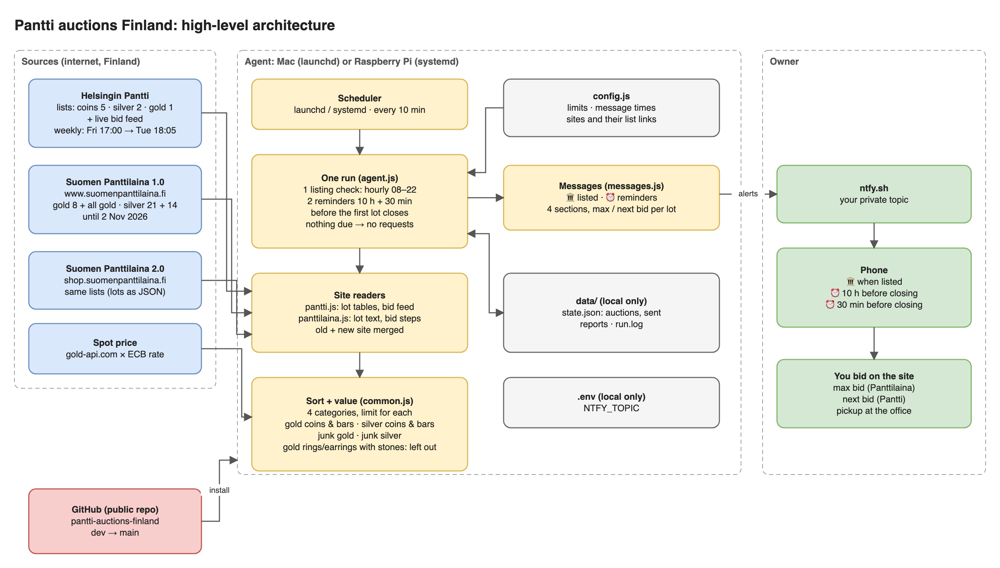

# Pantti auctions Finland: gold and silver

Watches the online auctions of two Finnish pawnshops for **gold and silver** and sends messages to your phone:

| Site | Auctions |
|---|---|
| **Helsingin Pantti** ([huutokauppa.pantti.fi](https://huutokauppa.pantti.fi)) | one a week: opens Friday 17:00, lots close Tuesday from about 18:05 |
| **Suomen Panttilaina** ([suomenpanttilaina.fi](https://www.suomenpanttilaina.fi/huutokauppa/)) | four offices, each every two weeks (Mon Vuosaari, Tue Kaivopiha, Wed Myyrmäki, Thu Hakaniemi), lots close from 19:00 |

Every lot is sorted into **four categories**, each with its own limits:

| Category | Examples | Default links read |
|---|---|---|
| **Gold coins & bars** | kultaraha, dukaatti, harkko, Krugerrand | Helsingin Pantti coins & medals · Suomen Panttilaina gold / other |
| **Silver coins & bars** | juhlaraha, hopearaha, silver medals | Helsingin Pantti coins & medals · Suomen Panttilaina silver / other |
| **Junk gold** | chains, broken jewellery, dental gold | Helsingin Pantti gold jewellery · Suomen Panttilaina all gold |
| **Junk silver** | cutlery, silverware, lots of silver | Helsingin Pantti silver · Suomen Panttilaina silver cutlery |

A lot goes to *coins & bars* or *junk* by its own text, whatever link it came from. **Left out completely:**
- gross-weight (br) gold;
- gold rings and earrings with stones;
- lots with less than 30 € of metal.

For **every auction** you get:

| When | Message |
|---|---|
| **Once, when it is listed** | 🏛 the lots in the four categories, each valued by its own weight and fineness at today's spot price, best value first, with 🟢 on the ones at your price |
| **10 hours before it closes** | ⏰ what to bid: per lot, the bid, how far below or above spot it is, and the lot's closing time |
| **30 minutes before it closes** | ⏰ the same, with fresh bids |

"Closes" means when the auction's first watched lot closes. Suomen Panttilaina takes **max bids** (the site bids for you up to your amount), so its advice is the **max bid to set**. Helsingin Pantti takes one bid at a time, so its advice is the **next bid** to place.

It is **not** an always-on service: your computer's scheduler starts it every 10 minutes; each run does what is due and exits, and reads nothing from the internet when nothing is due. It needs no AI, no account at either site, and no npm packages.

> Not affiliated with Helsingin Pantti or Suomen Panttilaina. Advice only: the agent never bids, and an auction can move between the message and your bid. Always check the lot yourself.



---

## How it decides

- **Metal content from the listing itself:**
  - Helsingin Pantti: each lot's table of rows (description, grams, fineness code such as `H925`, `H830BR`, `999,9`).
  - Suomen Panttilaina: the lot text, e.g. `Kultaraha …, 986, Paino: 14 g`.
- **Anything not clearly stated is "check by hand", never guessed:** no weight, `Paino: 0 g`, no fineness, plated, gold and silver in one lot.
- **br / BR** (gross weight, the lot holds other material too):
  - silver counts **30 %** of its weight;
  - gross-weight gold is left out.
- **Metal value** = fine grams × today's spot (gold-api.com × the ECB euro rate).
- **Your limits**, per category, as % of the metal value (kept private in `.env`, see below):
  - 🟢 when a lot can be had at your price;
  - the max bid never goes above your max.
  - Shipping is not included: you pick up.
- **The bid:**
  - Helsingin Pantti: the next legal bid from the lot's live bid feed (top bid + minimum raise, or the start price).
  - Suomen Panttilaina: the site's minimum next bid. The **max bid** is the highest amount on the site's bid steps (+2 / +5 / +10 / +20 / +50 / +100 €) that is not above your max.
- Otherwise a lot is "not at your price", closed, or check by hand.

Example: Suomen Panttilaina, 4 ducats `986, Paino: 14 g` (gold coins & bars, example max +3 %).

| Step | Amount |
|---|---|
| Fine gold | 13.80 g |
| Metal value (gold at 100 €/g) | 1 380 € |
| Your max (+3 %) | 1 421 € |
| Next bid on the site | 1 200 € |
| **Max bid to set** | **1 400 €** |

Example: junk silver worth 925 € in metal, with 🟢 at −10 % and max 0 %.

| Asking price | Result |
|---|---|
| 820 € | 🟢, max bid 920 € |
| 860 € | not 🟢 (only 7 % below metal value) |

Each message is sent **once**. If something fails (a site times out, ntfy is down), you get one ⚠ message and a later run tries again.

---

## Set up (about 10 minutes)

You need **Node.js 18+** and the free **ntfy** app on your phone.

```bash
git clone https://github.com/ammar93b/pantti-auctions-finland.git
cd pantti-auctions-finland
npm test                         # all tests should pass; there is nothing to install
```

**Phone:**
1. Install ntfy.
2. Make a private topic name just for this agent: `echo pantti-$(openssl rand -hex 5)`.
3. Subscribe to it in the app.

Use a separate topic for each app you run.

```bash
cp .env.example .env             # then set NTFY_TOPIC=<your topic> and your limits (below)
npm run test-push                # "🏛 Pantti auctions test" arrives on your phone
npm run show:list                # every auction listed now, lots and values (nothing sent)
npm run schedule:install         # start the runs (every 10 minutes)
npm run status
```

- **Mac:** a launchd agent (`fi.panttiauctions.agent`). A run missed while the Mac sleeps happens when it wakes.
- **Raspberry Pi / Linux:** a systemd user timer (`pantti-auctions.timer`) with `Persistent=true`. The install prints one extra command, `sudo loginctl enable-linger <you>`, so it also runs without anyone logged in.

The computer's own time zone does not matter: every time is worked out in Finnish time.

---

## Configure: message times

Everything is in **`config.js`**, under `notify`. After any change, nothing else is needed: the next run uses it. (Only `checkEveryMinutes` needs `npm run schedule:install` again.)

```js
notify: {
  whenListed: true,                     // one message when an auction is listed
  beforeClosing: ['10h', '30min'],      // reminders before the first lot closes
  listingCheckEvery: '60min',           // how often new listings are looked for
  listingCheckHours: ['08:00', '22:00'],// only between these times (Finnish time)
},
checkEveryMinutes: 10,                  // how often the scheduler starts the agent (5–60)
```

| You want | Write |
|---|---|
| Reminders 1 day, 2 hours and 15 minutes before | `beforeClosing: ['24h', '2h', '15min']` |
| Only one reminder, 1 h 30 min before | `beforeClosing: ['1h30min']` |
| No reminders | `beforeClosing: []` |
| No message when listed (reminders only) | `whenListed: false` |
| New listings noticed faster | `listingCheckEvery: '30min'` |
| Listing messages also in the late evening | `listingCheckHours: ['08:00', '23:30']` |

Times are written as hours and minutes: `'10h'`, `'30min'`, `'1h30min'`, `'45m'`. A reminder is sent at the first run after its time, so with `checkEveryMinutes: 10` it can come up to 10 minutes late. Pick reminder times at least `checkEveryMinutes` apart. If the computer was off, a missed reminder is skipped and the next one still comes.

## Configure: your limits (private, in `.env`)

Your limits are in **`.env`**, which stays on your computer and is never uploaded. Each value is a % of the lot's metal value at today's spot price.

| Key | Meaning |
|---|---|
| `<CATEGORY>_MAX_PCT` | the most you bid: `5` = 5 % above, `0` = never above, `-5` = 5 % below |
| `<CATEGORY>_ALERT_PCT` | optional: a lot is 🟢 only at or below this price. Default: the same as MAX |

`<CATEGORY>` is `GOLD_COINS`, `SILVER_COINS`, `JUNK_GOLD` or `JUNK_SILVER`. A value not set means 0 % (never above the metal value). Allowed values: −50 to 100.

```ini
# example: coins and bars up to 3 % over metal value
GOLD_COINS_MAX_PCT=3
SILVER_COINS_MAX_PCT=3
# example: junk 🟢 only at 10 % below metal value, and never bid above it
JUNK_GOLD_MAX_PCT=0
JUNK_GOLD_ALERT_PCT=-10
JUNK_SILVER_MAX_PCT=0
JUNK_SILVER_ALERT_PCT=-10
```

`npm run status` shows the limits in use. Other settings in `config.js`:

| Setting | Default | Meaning |
|---|---|---|
| `minMetalEur` | `30` | lots with less metal value are left out |
| `brSilverShare` | `0.30` | silver share of a gross-weight (br) silver lot |

## Configure: sites and links (add your own)

The agent reads the **lists** in `config.js` under `sources`. Each list is a link you copy from the site, with the site's own filters already chosen.

**How a lot finds its category:**
1. Its **metal**:
   - Helsingin Pantti: from the lot's own table.
   - Suomen Panttilaina: from the list's `metal`.
2. **Coins & bars or junk:** from its own text.

So any link you add feeds the right categories by itself. You only say which metal the list is, when it is a one-metal list.

**Helsingin Pantti:** `{auction}` stands for the week's auction number; the agent fills it in and adds the page number.

```js
pantti: {
  enabled: true,
  reference: { auction: 966, friday: '2026-10-16' },   // any known auction and its Friday
  lists: [
    // gold and silver coins & bars (both metals: no `metal`)
    { name: 'coins & medals', url: 'https://huutokauppa.pantti.fi/huutokauppa/{auction}/?category=5' },
    // junk silver
    { name: 'silver', metal: 'silver', url: 'https://huutokauppa.pantti.fi/huutokauppa/{auction}/?category=2' },
    // junk gold (`metal: 'gold'` keeps only the gold pieces of this jewellery list)
    { name: 'gold jewellery', metal: 'gold', url: 'https://huutokauppa.pantti.fi/huutokauppa/{auction}/?category=1' },
  ],
},
```

**Suomen Panttilaina:** every list needs a `metal` (the site has no metal field per lot). Each list has two links, both read and merged:
- `url`: the old site (Huutokauppa 1.0, until 2 Nov 2026);
- `newSiteUrl`: the new site (Huutokauppa 2.0).

A lot in two lists is counted once.

```js
panttilaina: {
  enabled: true,
  lists: [
    // gold coins & bars (other gold items in it → junk gold)
    { name: 'gold / other (coins, bars)', metal: 'gold',
      url: 'https://www.suomenpanttilaina.fi/huutokauppa/?product_category=1&product_sub_category=8',
      newSiteUrl: 'https://shop.suomenpanttilaina.fi/auction?SelectedProductSubCategories=8' },
    // silver coins & bars (other silver items in it → junk silver)
    { name: 'silver / other (coins)', metal: 'silver',
      url: 'https://www.suomenpanttilaina.fi/huutokauppa/?product_category=3&product_sub_category=21',
      newSiteUrl: 'https://shop.suomenpanttilaina.fi/auction?SelectedProductSubCategories=21' },
    // junk silver
    { name: 'silver / cutlery', metal: 'silver',
      url: 'https://www.suomenpanttilaina.fi/huutokauppa/?product_category=3&product_sub_category=14',
      newSiteUrl: 'https://shop.suomenpanttilaina.fi/auction?SelectedProductSubCategories=14' },
    // junk gold (coins and bars in it → gold coins & bars)
    { name: 'gold, all', metal: 'gold',
      url: 'https://www.suomenpanttilaina.fi/huutokauppa/?product_category=1&product_sub_category=',
      newSiteUrl: 'https://shop.suomenpanttilaina.fi/auction?SelectedProductCategories=1' },
  ],
  warnAfterDaysWithoutLots: 7,
},
```

**To add a link to a category:**
1. Open the site and choose its filters (category, subcategory, office).
2. Copy the page address.
3. Add a line to the site's `lists` with a `name`, the `metal` of that list and the link. For Suomen Panttilaina, put the old-site link in `url` and the matching new-site link in `newSiteUrl`.
4. Run `npm run show:list` to see the lots it adds, sorted into the categories.

| You want more of | Add (Suomen Panttilaina) |
|---|---|
| Junk silver: silver chains (subcategory 17) | `{ name: 'silver chains', metal: 'silver', url: '…/huutokauppa/?product_category=3&product_sub_category=17', newSiteUrl: '…/auction?SelectedProductSubCategories=17' }` |
| Junk silver: silver jewellery, other (20) | the same with `20` |
| Only one office | choose the office in the site's filter and copy that link |

| Other changes | Do |
|---|---|
| Only Suomen Panttilaina | `pantti: { enabled: false, … }` |
| Remove the old-site link after 2 Nov | delete the `url` line; `newSiteUrl` stays |

Suomen Panttilaina's subcategory numbers:

| Metal | Subcategories |
|---|---|
| **Gold** (category 1) | 8 other (coins, bars), 5 rings, 4 chains & necklaces, 6 earrings, 1 bracelets, 3 pendants, 2 brooches, 7 other jewellery, 42 cufflinks |
| **Silver** (category 3) | 21 other (coins), 14 cutlery, 18 rings, 17 chains & necklaces, 19 earrings, 13 bracelets, 16 pendants, 15 brooches, 20 other jewellery, 43 cufflinks |

Helsingin Pantti's categories used here: **5** coins & medals, **2** silver, **1** jewellery (gold).

## Commands

| Command | What it does |
|---|---|
| `npm run once` | What the scheduler runs: does what is due now, if anything |
| `npm run show` | Every auction listed now: lots, values and bid advice with live bids, printed (nothing sent) |
| `npm run show:list` | Lots and values from the lists only (fast) |
| `npm run push` | Like `show`, and sends each auction's advice to your phone |
| `npm run top` | Right now, across every open auction: the **5 best lots of each category**, one 🏆 message per category to your phone |
| `npm run status` | Auctions seen, reminders sent, failures, settings, your limits |
| `npm run test-push` | One test message |
| `npm run log` | Recent log lines |
| `npm run schedule:install` / `:remove` / `:status` / `:print` | The scheduled runs |
| `npm test` | Tests (saved copies of real auction pages) |

`npm run show -- --source panttilaina` shows one site; `npm run show -- --limit 5` reads only the first 5 lots of each list.

## Files

```
run.js               one run (scheduled or manual)
config.js            all settings: limits, message times, sites and links
src/agent.js         what is due: listing checks and reminders
src/pantti.js        Helsingin Pantti: lists, lot tables, bid feed
src/panttilaina.js   Suomen Panttilaina: old and new site lists, lot text, bid steps, max bid
src/common.js        Finnish time, fineness codes, valuation, the four categories, limits
src/messages.js      the phone messages
src/spot.js          gold and silver spot in euros
src/notify.js        ntfy
src/state.js         what was seen and sent (data/state.json), run lock, reports, log
src/http.js          web requests with retries
scripts/schedule.js  launchd / systemd install
docs/                architecture diagram (draw.io + PNG)
specs/               full specifications
test/                tests and saved auction pages
```

`.env` holds `NTFY_TOPIC`, your limits and optionally `TZ`. It and `data/` (state, reports, log) stay on your computer and are never committed.

## If something goes wrong

| Problem | Fix |
|---|---|
| No messages | `npm run test-push`; check the topic in `.env` and in the app |
| "Helsingin Pantti auction … has no lots" | Pantti skipped or renumbered a week: set `reference` to a current auction and its Friday |
| "Suomen Panttilaina reading failed: no lots found for 7 days" | The site moved its lists: open the site, copy the gold / silver list links into `config.js` |
| Nothing arrives at all | `npm run schedule:status`, `npm run status`, `npm run log`: is the computer on? |
| A site changed its pages | The tests fail on fresh pages; update the parser in `src/pantti.js` or `src/panttilaina.js` and the saved pages in `test/fixtures/` |

The full design is in [`specs/`](specs/README.md).

## Licence

[MIT](LICENSE). Use, change and share it freely.
